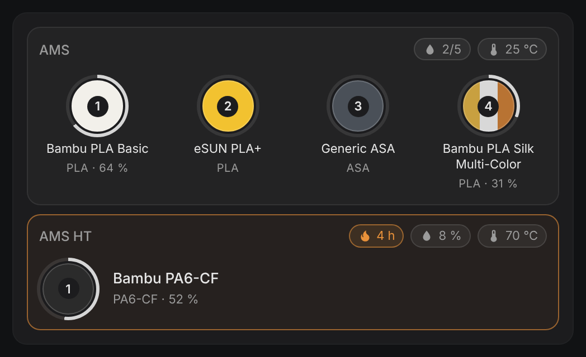
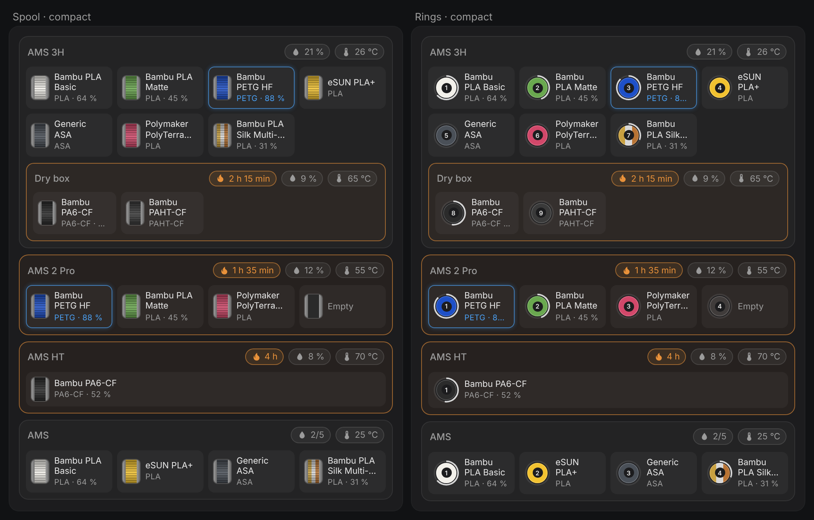
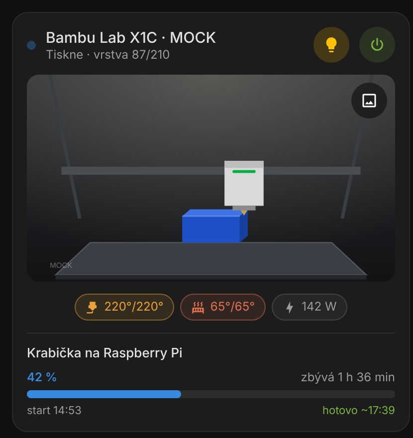

# Bambu Lab Cards

[](https://hacs.xyz/docs/faq/custom_repositories)

[](https://my.home-assistant.io/redirect/hacs_repository/?owner=CzechTropi&repository=bambulab-card&category=plugin)

**English** · [Česky](#česky)

Three minimalist Home Assistant dashboard cards for Bambu Lab 3D printers, built on the [ha-bambulab](https://github.com/greghesp/ha-bambulab) integration:

- **Printer** – camera, print progress, temperatures and errors at a glance
- **AMS** – the spools in one or more AMS units, styled like Bambu Studio
- **Spool** – the external spool (or a single AMS tray) in the same look as the AMS

You'll find them in the card picker as **CzechTropi · Bambu Lab Printer / AMS / Spool**. Every option is in the visual editor, in English or Czech depending on your Home Assistant language.

**No printer at hand?** Every card has a **MOCK** data source with made-up data – see [Try it with mock data](#try-it-with-mock-data).

## Printer card


- Live camera, one tap switches to the print preview (cover image)
- Status line with the current stage – bed leveling, heating, filament change, pause reason…
- Nozzle and bed temperature (current / target)
- Progress bar, layers, remaining time, start and estimated finish
- HMS and print errors with a link to the Bambu wiki
- Chamber light toggle and an optional smart plug with live wattage
- Knows when the printer is off even without a smart plug – no stale temperatures then

<table>
  <tr>
    <td align="center"><br><sub>Print preview</sub></td>
    <td align="center"><br><sub>Stage while preparing the print</sub></td>
    <td align="center"><br><sub>Visual editor</sub></td>
  </tr>
</table>

| Option | Description |
| --- | --- |
| `printer` | **Required.** The printer device |
| `power_switch` | Smart plug powering the printer – wattage is read from the same device |
| `camera` | Camera entity, default: the printer camera |
| `name` | Card title, default: the device name |
| `icon_*`, `color_*` | Own icons and colors for light, power, nozzle, bed, usage and progress |

## AMS card

Shows one or more AMS units in the order you pick them, styled like Bambu Studio: color, filament name, type and the remaining filament of every spool, plus the humidity and temperature of each AMS. The spool the printer uses is highlighted. Tap a spool to open the same filament dialog as the ha-bambulab cards (filament type and color, load, unload, re-read RFID).

Every AMS gets the same width, so a spool is the same size in all of them. In a normal dashboard column the AMS are stacked; give the card more width (e.g. a section spanning two columns) and they sit side by side.

**AMS 3H (H3C)** shows the main zone in rows of four and the dry box in its own frame, each with its humidity and temperature. While an AMS dries – the AMS 3H dry box, AMS 2 Pro or AMS HT – an orange chip with a flame shows the time left and the unit gets an orange frame.


**Two styles** – drawn spools (`spool`) or rings (`rings`, the ring around a spool is the remaining filament) – and **two sizes**. **Compact** keeps everything (name, type, remaining) but puts a spool in a small tile, four in a row: an AMS takes a single row, handy for several AMS on one printer. An **AMS HT** (one spool) has the same header as the other units, with the spool and its details below.





The AMS Lite has no humidity or temperature sensor, so you can pick **your own sensors** – e.g. from a filament dryer. It works for any AMS: your sensor replaces the built-in reading.


| Option | Default | Description |
| --- | --- | --- |
| `ams` | – | **Required.** AMS units, in display order |
| `style` | `spool` | `spool` or `rings` |
| `size` | `normal` | `normal` or `compact` |
| `custom_humidity`, `custom_temperature` | – | Own sensors (in the editor for each AMS; YAML with several AMS: `custom_sensors`) |
| `show_labels` | on | AMS names |

## Spool card

Shows the external spool – so it also works for printers without an AMS – or a single AMS tray, in the same look as the AMS card. Placed above or below the AMS card, it lines up with it. **Normal** shows the spool with its name, type and remaining next to it; **compact** is one slim line.


| Option | Default | Description |
| --- | --- | --- |
| `spool` | – | **Required.** The external spool, or an AMS together with `tray` |
| `style` | `spool` | `spool` or `rings` |
| `size` | `normal` | `normal` or `compact` (one slim line) |
| `show_external` | `always` | `always`, or `active` – the card shows only while the printer prints from this spool |

**Both filament cards** also have `title`, `show_name`, `show_type`, `highlight_active`, `color_active` and `show_remaining`. The remaining percentage is only known for Bambu spools with RFID – the printer reports 100 % for anything else, so by default it's hidden there.

Older configs keep working: `style: compact` shows rings, `external_style: slim` is the compact spool card and `panel` the normal one.

## Try it with mock data

At the top of each card editor, switch **Data Source** to **Mock data (MOCK)**. The device picker is replaced by a choice of made-up data, so you can see the cards without the hardware – e.g. an AMS 3H you don't own. Nothing is read from or sent to the printer; the card title says MOCK.



- **Printer** – state: printing, paused, preparing, finished, ready or error (HMS). Comes with a drawn camera view; the light and power buttons work inside the card only.
- **AMS** – any mix of AMS 3H with the dry box, AMS 2 Pro (drying), AMS HT (drying), AMS and AMS Lite
- **Spool** – the external spool, the external spool in use, or an AMS tray with multi-color filament

```yaml
type: custom:bambulab-card
printer: MOCK
mock: printing        # pause, prepare, finish, idle, error
```

```yaml
type: custom:bambulab-ams-card
ams: MOCK
mock: [ams_3h, ams_2_pro, ams_ht, ams, ams_lite]
```

```yaml
type: custom:bambulab-spool-card
spool: MOCK
mock: external_active # external, ams_tray
```

## Installation

Click the button at the top, download the card and reload the browser (Ctrl+F5). Or add it by hand:

- **Home Assistant 2026.11+:** Settings → **Marketplace** → **Add from link** → `https://github.com/CzechTropi/bambulab-card`
- **Older versions (HACS):** HACS → ⋮ → **Custom repositories** → the same URL, type **Dashboard**

Needs Home Assistant 2024.8+ and the [ha-bambulab](https://github.com/greghesp/ha-bambulab) integration. The cards find the printer's entities by themselves, so renamed entities are fine. If something is missing (layers, start / end time), enable that entity in the device settings.

## YAML example

```yaml
type: custom:bambulab-card
printer: <device_id>
power_switch: switch.printer_plug
```

```yaml
type: custom:bambulab-ams-card
ams:
  - <AMS device_id>
style: rings
size: compact
custom_humidity: sensor.dryer_humidity
custom_temperature: sensor.dryer_temperature
```

```yaml
type: custom:bambulab-spool-card
spool: <external spool device_id>
size: compact
show_external: active
```

---

## Česky

Tři minimalistické karty do Home Assistantu pro 3D tiskárny Bambu Lab, postavené na integraci [ha-bambulab](https://github.com/greghesp/ha-bambulab):

- **Printer** – kamera, průběh tisku, teploty a chyby na první pohled
- **AMS** – špulky v jednom nebo více AMS, ve stylu Bambu Studia
- **Spool** – externí špulka (nebo jeden slot AMS) ve stejném vzhledu jako AMS

Ve výběru karet je najdeš jako **CzechTropi · Bambu Lab Printer / AMS / Spool**. Všechno se nastavuje ve vizuálním editoru, česky nebo anglicky podle jazyka Home Assistantu.


**Printer** – živá kamera (klepnutím přepneš na náhled tisku), aktuální fáze tisku, teplota trysky a podložky, průběh s počtem vrstev a časem dokončení, HMS chyby s odkazem na wiki Bambu, světlo a volitelně chytrá zásuvka s příkonem. Vypnutou tiskárnu pozná i bez chytré zásuvky – staré teploty pak neukazuje.

**AMS** – jedno nebo více AMS v pořadí, v jakém je vybereš. U každé špulky barva, název, typ a zbývající filament, aktivní špulka je zvýrazněná. Klepnutím na špulku otevřeš stejný dialog filamentu jako v kartách ha-bambulab (typ a barva filamentu, zavést, vysunout, znovu načíst RFID). Každé AMS má stejnou šířku, takže jsou špulky všude stejně velké; v běžném sloupci plochy jsou AMS pod sebou, v širší sekci vedle sebe. **Dva styly** – kreslené špulky nebo kolečka (prstenec kolem kolečka je zbývající filament) – a **dvě velikosti**: kompaktní ukáže všechno, jen každou špulku jako malou dlaždici, čtyři na řádek, takže jedno AMS zabere jediný řádek. **AMS 3H (H3C)** má hlavní zónu v řadách po čtyřech a pod ní sušicí box, každý se svou vlhkostí a teplotou. Při sušení (AMS 3H, AMS 2 Pro, AMS HT) ukáže oranžový čip s ohýnkem zbývající čas a AMS dostane oranžový rámeček. Ke každému AMS můžeš zvolit **vlastní senzor vlhkosti a teploty** – hodí se hlavně u AMS Lite, které vlastní senzory nemá.

**Spool** – externí špulka (funguje i u tiskáren bez AMS) nebo jeden slot AMS, ve stejném vzhledu jako karta AMS. Normální velikost ukáže špulku a vedle ní název, typ a zbytek, kompaktní je jeden úzký řádek. Může se zobrazit jen ve chvíli, kdy se z ní tiskne. Nad nebo pod kartou AMS s ní lícuje.

**Ukázková data (MOCK):** v editoru každé karty přepni nahoře **Zdroj dat** na **Ukázková data (MOCK)** a vyber, co chceš vidět – stav tiskárny (i s nakreslenou kamerou), libovolná AMS včetně AMS 3H nebo externí špulku. Z tiskárny se nic nečte ani se do ní nic neposílá.

Procenta zbývajícího filamentu zná tiskárna jen u špulek Bambu s RFID, u ostatních je karta ve výchozím stavu skrývá.

**Instalace:** klikni na tlačítko nahoře, stáhni kartu a obnov prohlížeč (Ctrl+F5). Nebo Nastavení → **Marketplace** → **Add from link** → `https://github.com/CzechTropi/bambulab-card`. Volby v YAML jsou v [anglické části](#printer-card).

## License

MIT
