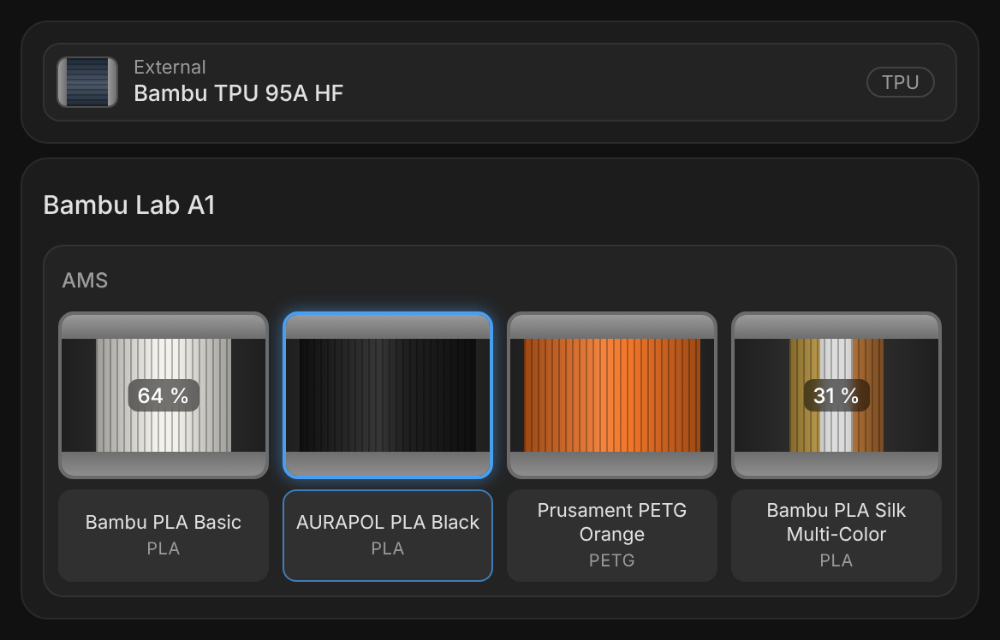
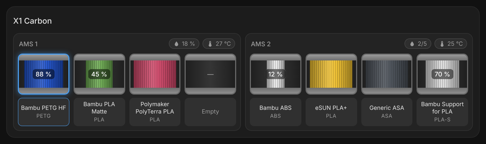
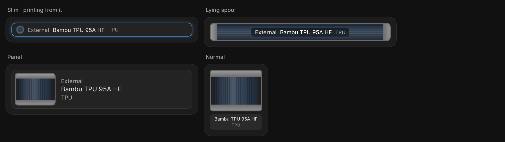
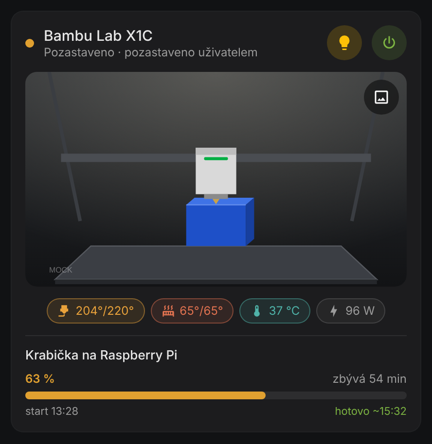

# Bambu Lab Cards

[](https://hacs.xyz/docs/faq/custom_repositories)

[](https://my.home-assistant.io/redirect/hacs_repository/?owner=CzechTropi&repository=bambulab-card&category=plugin)

**English** · [Česky](#česky)

Minimalist Home Assistant cards for Bambu Lab 3D printers, for the [ha-bambulab](https://github.com/greghesp/ha-bambulab) integration. In the card picker search for **CzechTropi**.

| Card | Shows |
| --- | --- |
| **Printer** | Camera / print preview, nozzle & bed temperature, progress with ETA, HMS errors, chamber light, smart plug |
| **AMS** | One or more AMS units; optional own humidity / temperature sensors (e.g. from a filament dryer) |
| **Spool** | The external spool (also without an AMS) or one AMS tray – normal, slim, lying spool or panel |

Everything is set up in the visual editor, in Czech or English (follows your Home Assistant language).

## Printer card


<table>
  <tr>
    <td align="center"><br><sub>Print preview – tap the image icon</sub></td>
    <td align="center"><br><sub>Current stage while preparing</sub></td>
    <td align="center"><br><sub>Visual editor</sub></td>
  </tr>
</table>

## AMS & Spool cards

Put the Spool card above or below the AMS card and they line up as one block.



**AMS** – several AMS fit as many in a row as the width allows and every spool keeps the same size. The AMS Lite has no humidity or temperature sensor, but you can pick your own for any AMS, e.g. from a dryer.




**Spool** – four looks. Optionally it shows only while the printer prints from it.



The remaining % is shown only for Bambu spools with RFID – other filament always reports 100 %.

## Installation

Click the button at the top, download the card and reload the browser (Ctrl+F5). Or by hand:

- **Home Assistant 2026.11+:** Settings → **Marketplace** → **Add from link** → `https://github.com/CzechTropi/bambulab-card`
- **Older versions (HACS):** HACS → ⋮ → **Custom repositories** → the same URL, type **Dashboard**

Requires Home Assistant 2024.8+ and the [ha-bambulab](https://github.com/greghesp/ha-bambulab) integration. If a part of the printer card is missing (layers, start / end time), enable that entity in the device settings.

## YAML

```yaml
type: custom:bambulab-card
printer: <device_id>
power_switch: switch.printer_plug   # optional, wattage from the same device
camera: camera.my_camera            # optional, default: printer camera
```

```yaml
type: custom:bambulab-ams-card
ams:                                # in this order
  - <AMS device_id>
custom_humidity: sensor.dryer_humidity        # optional (several AMS: custom_sensors per AMS)
custom_temperature: sensor.dryer_temperature  # optional
```

```yaml
type: custom:bambulab-spool-card
spool: <external spool device_id>   # or an AMS + tray: 1–4
external_style: ribbon              # normal, slim, ribbon (lying spool), panel
show_external: active               # always, active = only while in use
```

Common options: `title`, `show_remaining` (`auto` / `always` / `never`), `style` (`spool` / `compact`), `show_name`, `show_type`, `highlight_active`, `color_active`. Printer card: custom `icon_*` and `color_*`.

---

## Česky

Minimalistické karty do Home Assistantu pro 3D tiskárny Bambu Lab, pro integraci [ha-bambulab](https://github.com/greghesp/ha-bambulab). Ve výběru karet hledej **CzechTropi**.

| Karta | Co ukazuje |
| --- | --- |
| **Printer** | Kamera / náhled tisku, teplota trysky a podložky, průběh s časem dokončení, HMS chyby, světlo, chytrá zásuvka |
| **AMS** | Jedno nebo více AMS; volitelně vlastní senzory vlhkosti a teploty (třeba ze sušičky) |
| **Spool** | Externí špulka (i bez AMS) nebo slot AMS – normální, slim, ležící špulka nebo panel; může se ukázat jen při tisku z ní |



**Instalace:** klikni na tlačítko nahoře, stáhni kartu a obnov prohlížeč (Ctrl+F5). Nebo Nastavení → **Marketplace** → **Add from link** → `https://github.com/CzechTropi/bambulab-card`. Vše se nastavuje ve vizuálním editoru, YAML je v [anglické části](#yaml).

Kartu Spool dej nad nebo pod kartu AMS a budou lícovat. Procenta zbývajícího filamentu se ukážou jen u špulek Bambu s RFID.

## License

MIT
