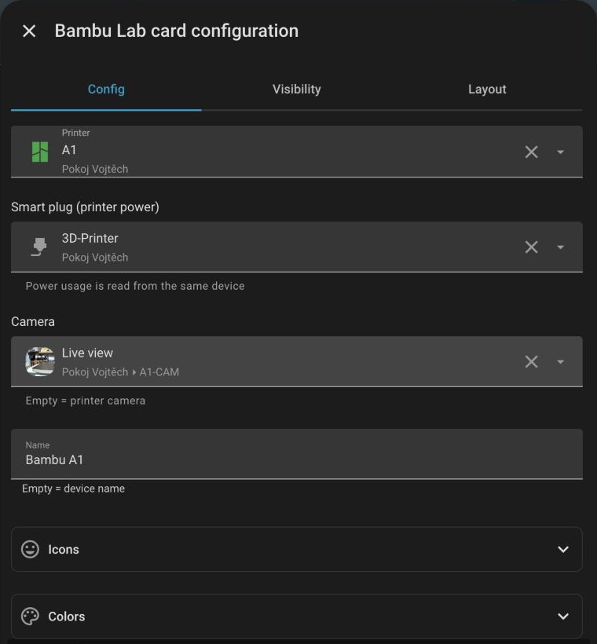

# Bambu Lab Printer Card

[](https://hacs.xyz/docs/faq/custom_repositories)

**English** · [Česky](#česky)

A minimalist Home Assistant dashboard card for Bambu Lab 3D printers: live camera / print preview, nozzle & bed temperatures, print progress with ETA, HMS errors, chamber light and smart-plug power.

Also includes [filament cards](#filament-cards-ams--external-spool) for the AMS and the external spool.

Works with all Bambu Lab printers supported by the [ha-bambulab](https://github.com/greghesp/ha-bambulab) integration.


<table>
  <tr>
    <td align="center"><br><sub>Print preview – one tap on the image icon</sub></td>
    <td align="center"><br><sub>Current stage while preparing the print</sub></td>
    <td align="center"><br><sub>Visual editor</sub></td>
  </tr>
</table>

## Features

- Live camera with a one-tap switch to the print preview (cover image)
- Status line with the current stage (bed leveling, heating, filament change, pause reason…)
- Nozzle and bed temperature chips (current / target)
- Progress bar, layer count, remaining time, start and finish time
- HMS and print errors with a link to the Bambu wiki
- Chamber light toggle, optional smart plug (power state + wattage)
- Visual editor, customizable icons and colors
- Czech and English UI (follows your Home Assistant language)

## Requirements

- Home Assistant 2024.8 or newer
- [ha-bambulab](https://github.com/greghesp/ha-bambulab) integration (HACS)

The card finds the printer entities automatically by their `translation_key` on the selected device, so renaming entities doesn't break it. If some part is missing (e.g. layers or start/end time), make sure the corresponding entity is **enabled** in the device settings.

## Installation

### HACS (recommended)

1. HACS → ⋮ (top right) → **Custom repositories**
2. Repository: `https://github.com/CzechTropi/bambulab-card`, type: **Dashboard**
3. Find **Bambu Lab Printer & Filament Cards** in HACS and download it
4. Reload the browser (Ctrl+F5)

### Manual

1. Copy `bambulab-card.js` to `/config/www/`
2. Settings → Dashboards → ⋮ → **Resources** → Add resource: `/local/bambulab-card.js`, type **JavaScript module**
3. Reload the browser

## Configuration

Add the card from the card picker (search for **Bambu Lab**) and pick your printer in the editor, or use YAML:

```yaml
type: custom:bambulab-card
printer: <device_id>            # Bambu Lab device (pick it in the visual editor)
power_switch: switch.printer_plug  # optional – smart plug
camera: camera.my_camera        # optional – defaults to the printer camera
name: My printer                # optional – defaults to the device name
```

| Option | Description |
| --- | --- |
| `printer` | **Required.** Device from the Bambu Lab integration |
| `power_switch` | Smart plug / switch powering the printer. Wattage is read from a `power` sensor on the same device |
| `power_sensor` | Override the power sensor |
| `camera` | Camera entity (default: printer camera) |
| `preview`, `light` | Override the preview image / chamber light entity |
| `name` | Card title |
| `icon_light`, `icon_power`, `icon_nozzle`, `icon_bed`, `icon_usage` | Custom icons (`mdi:…`) |
| `color_light`, `color_power`, `color_nozzle`, `color_bed`, `color_progress` | Custom colors (HA color name or CSS color) |
| `entities` | Map to override any resolved entity, e.g. `{ progress: sensor.xyz }` |

## Filament cards (AMS & external spool)

Three more cards in the same file, styled like the AMS in Bambu Studio. **The remaining % is shown only where the printer really knows it** (Bambu spools with RFID) – third-party filament always reports 100 %, so it's hidden by default.


| Card | Shows |
| --- | --- |
| `custom:bambulab-filament-card` | All AMS units + the external spool of a printer, side by side |
| `custom:bambulab-ams-card` | One AMS, with humidity and temperature |
| `custom:bambulab-spool-card` | Just the external spool |

Also: your own name and remaining-filament entity per slot, active spool highlight, `spool` / `compact` style, tap a spool for details. Everything is set in the visual editor.

<details>
<summary>More screenshots</summary>


 


</details>

### Configuration

```yaml
type: custom:bambulab-filament-card
printer: <device_id>
overrides:                    # optional, per spool sensor
  sensor.a1_ams_tray_2:
    name: Aurapol black
    remaining: input_number.aurapol_black_grams
```

The AMS card takes `ams: <device_id>`, the spool card `spool: <device_id>` (or `entity:`) instead of `printer`. Next to an AMS card, give the spool card a `title` too – both then line up.

| Option | Cards | Default | Description |
| --- | --- | --- | --- |
| `printer` / `ams` / `spool`, `entity` | – | – | **Required** device (filament card: `ams` can be a list to show only some AMS units) |
| `title` | all | – | Card title |
| `show_remaining` | all | `auto` | `auto` = Bambu RFID only, `always`, `never` |
| `show_name`, `show_type` | all | `true` | Filament name / type under the spool |
| `highlight_active`, `color_active` | all | `true`, blue | Highlight of the spool that is printing |
| `style` | all | `spool` | `spool` or `compact` |
| `show_info` | ams, filament | `true` | AMS humidity and temperature (never on AMS Lite – no sensors) |
| `show_external`, `external_position`, `show_labels` | filament | `true`, `start`, `true` | External spool on/off, left / right, group labels |
| `name_1`…`4`, `remaining_1`…`4` | ams | – | Custom name / remaining-filament entity per slot (spool card: `name`, `remaining`) |
| `overrides` | all | – | Per spool sensor: `name`, `remaining`, `color`, `max` (full amount, default 100 %, 1000 g or 1 kg) |

---

## Česky

Minimalistická karta do Home Assistantu pro 3D tiskárny Bambu Lab: živá kamera / náhled tisku, teplota trysky a podložky, průběh tisku s časem dokončení, HMS chyby, světlo a napájení přes chytrou zásuvku. K tomu [karty na filament](#karty-na-filament-ams-a-externí-špulka) pro AMS a externí špulku.

Funguje se všemi tiskárnami Bambu Lab, které podporuje integrace [ha-bambulab](https://github.com/greghesp/ha-bambulab).


### Předpoklady

- Home Assistant 2024.8 nebo novější
- Integrace [ha-bambulab](https://github.com/greghesp/ha-bambulab) (z HACS)

Karta si entity najde sama podle `translation_key` na vybraném zařízení, takže jí nevadí přejmenování entit. Pokud se některá část nezobrazuje (vrstvy, čas startu/konce…), zkontroluj, že je daná entita v nastavení zařízení **povolená**.

### Instalace přes HACS

1. HACS → ⋮ (vpravo nahoře) → **Vlastní repozitáře**
2. Repozitář: `https://github.com/CzechTropi/bambulab-card`, typ: **Dashboard**
3. Najdi v HACS **Bambu Lab Printer & Filament Cards** a stáhni
4. Obnov prohlížeč (Ctrl+F5)

### Použití

Přidej kartu přes výběr karet (hledej **Bambu Lab**) a v editoru vyber svou tiskárnu. Volitelně přidej zásuvku, kameru, název, vlastní ikony a barvy.

### Karty na filament (AMS a externí špulka)

Ve stejném souboru jsou i tři karty na filament ve stylu AMS z Bambu Studia: všechno z tiskárny najednou (`bambulab-filament-card`), jedno AMS (`bambulab-ams-card`) a jen externí špulka (`bambulab-spool-card`). **Procenta zbývajícího filamentu se ukážou jen tam, kde je tiskárna opravdu zná** (Bambu s RFID) – u ostatních filamentů hlásí vždy 100 %, proto je karta ve výchozím stavu schová. Každému slotu můžeš dát vlastní název i entitu se zbývajícím množstvím. Všechno se nastavuje ve vizuálním editoru, volby v YAML jsou v [anglické části](#configuration-1).


## License

MIT
