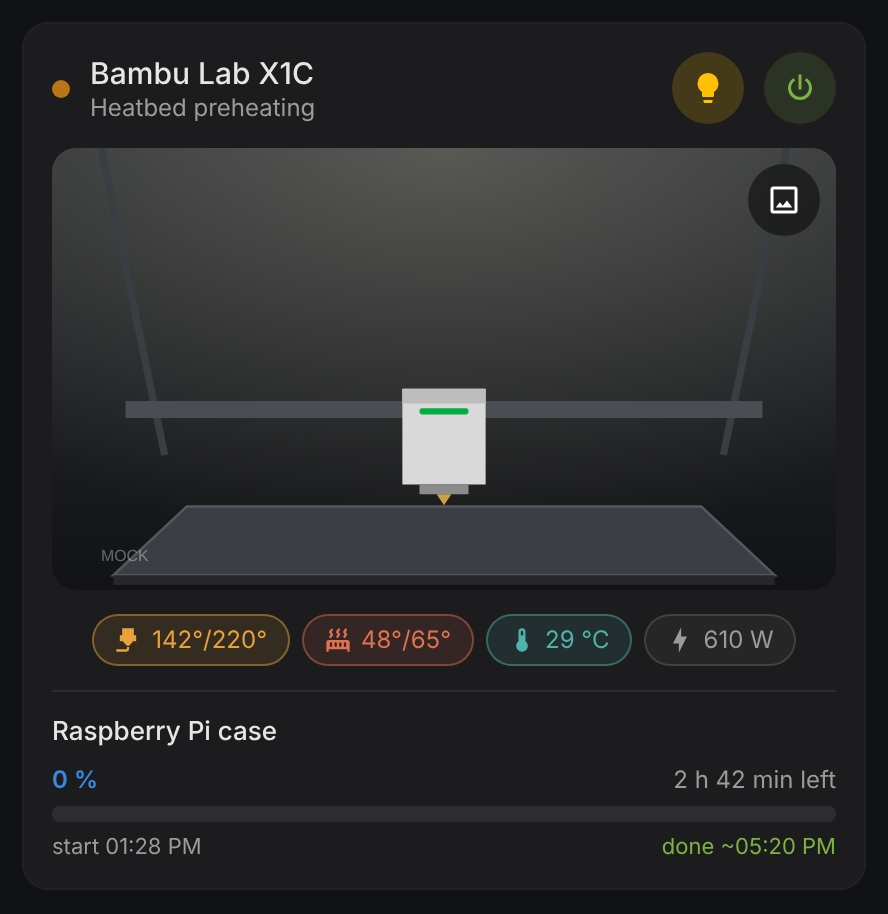
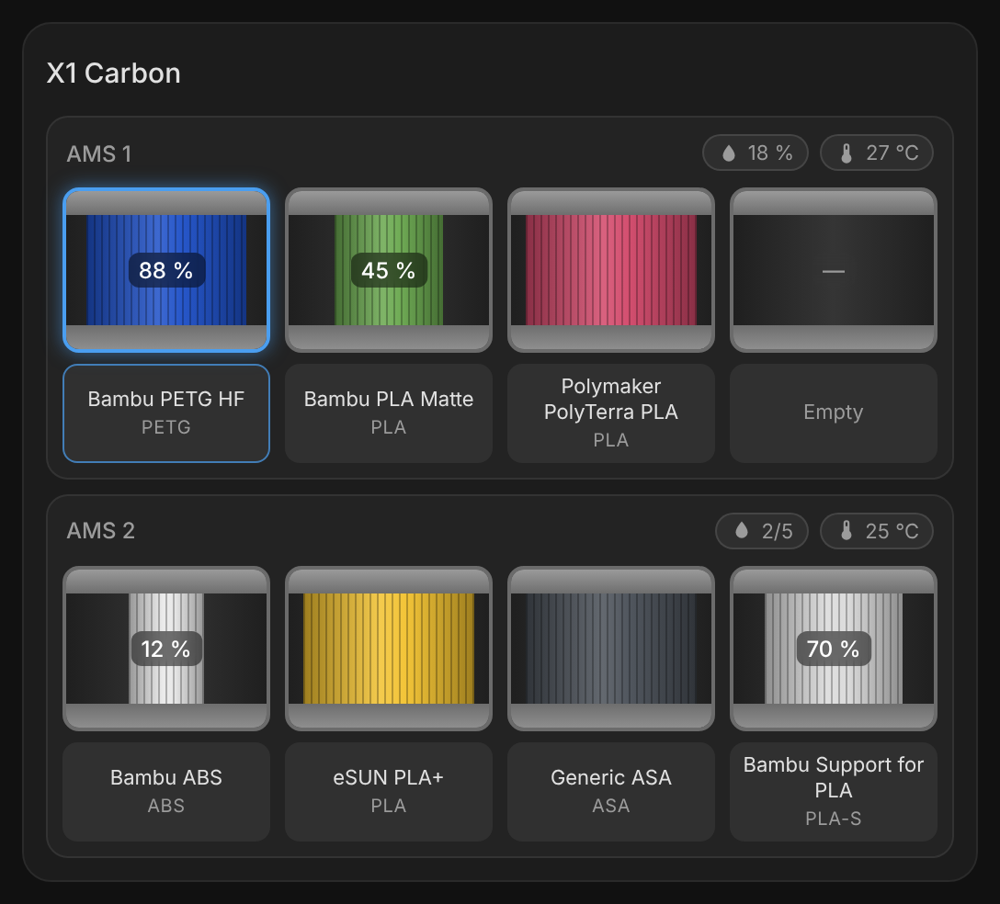
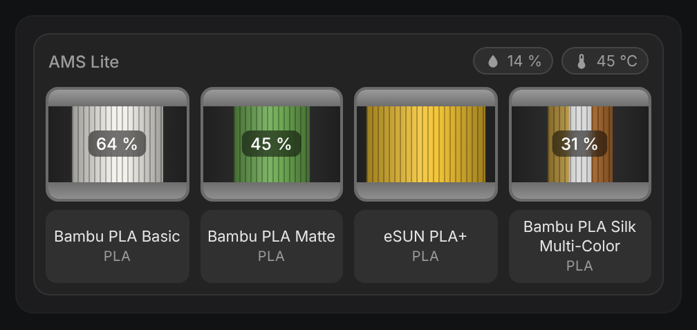

# Bambu Lab Cards

[](https://hacs.xyz/docs/faq/custom_repositories)

[](https://my.home-assistant.io/redirect/hacs_repository/?owner=CzechTropi&repository=bambulab-card&category=plugin)

**English** · [Česky](#česky)

Three minimalist Home Assistant dashboard cards for Bambu Lab 3D printers, built on the [ha-bambulab](https://github.com/greghesp/ha-bambulab) integration:

- **Printer** – camera, print progress, temperatures and errors at a glance
- **AMS** – the spools in one or more AMS units, styled like Bambu Studio
- **Spool** – the external spool (or a single AMS tray) in one of four looks

You'll find them in the card picker as **CzechTropi · Bambu Lab Printer / AMS / Spool**. Every option is in the visual editor, in English or Czech depending on your Home Assistant language.

## Printer card


- Live camera, one tap switches to the print preview (cover image)
- Status line with the current stage – bed leveling, heating, filament change, pause reason…
- Nozzle and bed temperature (current / target)
- Progress bar, layers, remaining time, start and estimated finish
- HMS and print errors with a link to the Bambu wiki
- Chamber light toggle and an optional smart plug with live wattage

<table>
  <tr>
    <td align="center"><br><sub>Print preview</sub></td>
    <td align="center"><br><sub>Stage while preparing the print</sub></td>
    <td align="center"><br><sub>Visual editor</sub></td>
  </tr>
</table>

| Option | Description |
| --- | --- |
| `printer` | **Required.** The printer device |
| `power_switch` | Smart plug powering the printer – wattage is read from the same device |
| `camera` | Camera entity, default: the printer camera |
| `name` | Card title, default: the device name |
| `icon_*`, `color_*` | Own icons and colors for light, power, nozzle, bed, usage and progress |

## AMS card

Shows one or more AMS units in the order you pick them. Each spool shows its color, filament name and type; the spool the printer is using is highlighted. Several AMS are stacked under each other in a normal dashboard column; give the card more width (e.g. a section spanning two columns) and they sit side by side. Every spool keeps the same size either way.



The AMS Lite has no humidity or temperature sensor, so you can pick **your own sensors** – e.g. from a filament dryer. It works for any AMS: your sensor replaces the built-in reading.



| Option | Default | Description |
| --- | --- | --- |
| `ams` | – | **Required.** AMS units, in display order |
| `custom_humidity`, `custom_temperature` | – | Own sensors (in the editor for each AMS; YAML with several AMS: `custom_sensors`) |
| `show_info` | on | Humidity and temperature of each AMS |
| `show_labels` | on | AMS names |
| `style` | `spool` | `spool` or `compact` (color dots) |

## Spool card

Shows the external spool – so it also works for printers without an AMS – or a single AMS tray. Placed above or below the AMS card, it lines up with it.


| Option | Default | Description |
| --- | --- | --- |
| `spool` | – | **Required.** The external spool, or an AMS together with `tray` |
| `external_style` | `normal` | `normal`, `slim`, `ribbon` (lying spool) or `panel` |
| `show_external` | `always` | `always`, or `active` – the card shows only while the printer prints from this spool |

**Both filament cards** also have `title`, `show_name`, `show_type`, `highlight_active` and `color_active`, and `show_remaining`. The remaining percentage is only known for Bambu spools with RFID – the printer reports 100 % for anything else, so by default it's hidden there.

## Installation

Click the button at the top, download the card and reload the browser (Ctrl+F5). Or add it by hand:

- **Home Assistant 2026.11+:** Settings → **Marketplace** → **Add from link** → `https://github.com/CzechTropi/bambulab-card`
- **Older versions (HACS):** HACS → ⋮ → **Custom repositories** → the same URL, type **Dashboard**

Needs Home Assistant 2024.8+ and the [ha-bambulab](https://github.com/greghesp/ha-bambulab) integration. The cards find the printer's entities by themselves, so renamed entities are fine. If something is missing (layers, start / end time), enable that entity in the device settings.

## YAML example

```yaml
type: custom:bambulab-card
printer: <device_id>
power_switch: switch.printer_plug
```

```yaml
type: custom:bambulab-ams-card
ams:
  - <AMS device_id>
custom_humidity: sensor.dryer_humidity
custom_temperature: sensor.dryer_temperature
```

```yaml
type: custom:bambulab-spool-card
spool: <external spool device_id>
external_style: ribbon
show_external: active
```

---

## Česky

Tři minimalistické karty do Home Assistantu pro 3D tiskárny Bambu Lab, postavené na integraci [ha-bambulab](https://github.com/greghesp/ha-bambulab):

- **Printer** – kamera, průběh tisku, teploty a chyby na první pohled
- **AMS** – špulky v jednom nebo více AMS, ve stylu Bambu Studia
- **Spool** – externí špulka (nebo jeden slot AMS) ve čtyřech podobách

Ve výběru karet je najdeš jako **CzechTropi · Bambu Lab Printer / AMS / Spool**. Všechno se nastavuje ve vizuálním editoru, česky nebo anglicky podle jazyka Home Assistantu.


**Printer** – živá kamera (klepnutím přepneš na náhled tisku), aktuální fáze tisku, teplota trysky a podložky, průběh s počtem vrstev a časem dokončení, HMS chyby s odkazem na wiki Bambu, světlo a volitelně chytrá zásuvka s příkonem.

**AMS** – jedno nebo více AMS v pořadí, v jakém je vybereš. U každé špulky barva, název a typ filamentu, aktivní špulka je zvýrazněná. Víc AMS je v běžném sloupci plochy pod sebou; když kartě dáš víc místa (třeba sekci přes dva sloupce), jsou vedle sebe. Ke každému AMS můžeš zvolit **vlastní senzor vlhkosti a teploty** – hodí se hlavně u AMS Lite, které vlastní senzory nemá, třeba se senzorem ze sušičky.

**Spool** – externí špulka (funguje i u tiskáren bez AMS) nebo jeden slot AMS. Vzhled normální, slim, ležící špulka nebo panel. Může se zobrazit jen ve chvíli, kdy se z ní tiskne. Nad nebo pod kartou AMS s ní lícuje.

Procenta zbývajícího filamentu zná tiskárna jen u špulek Bambu s RFID, u ostatních je karta ve výchozím stavu skrývá.

**Instalace:** klikni na tlačítko nahoře, stáhni kartu a obnov prohlížeč (Ctrl+F5). Nebo Nastavení → **Marketplace** → **Add from link** → `https://github.com/CzechTropi/bambulab-card`. Volby v YAML jsou v [anglické části](#printer-card).

## License

MIT
