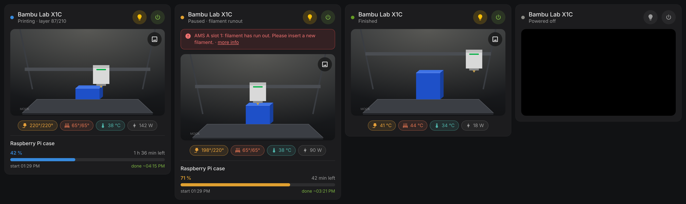
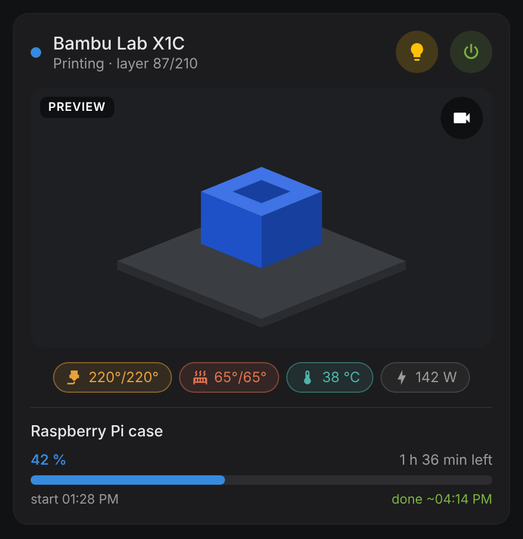
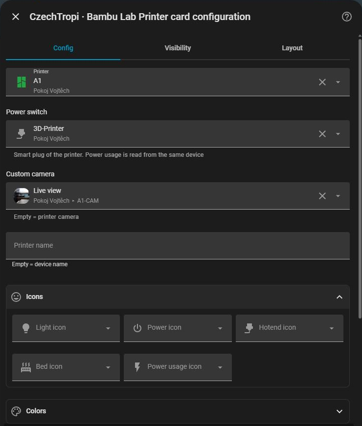
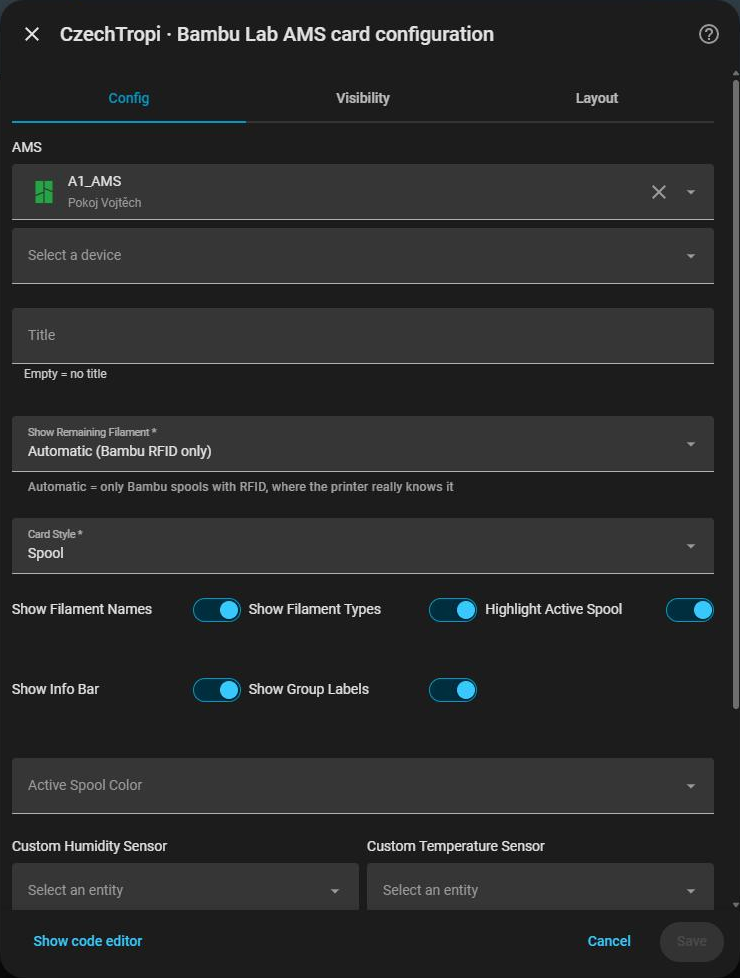
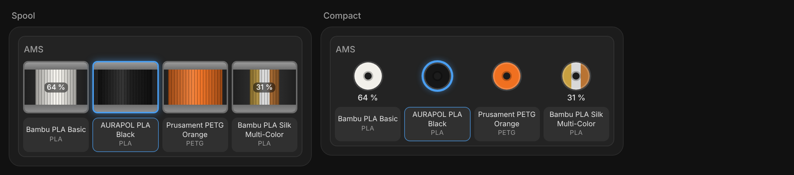
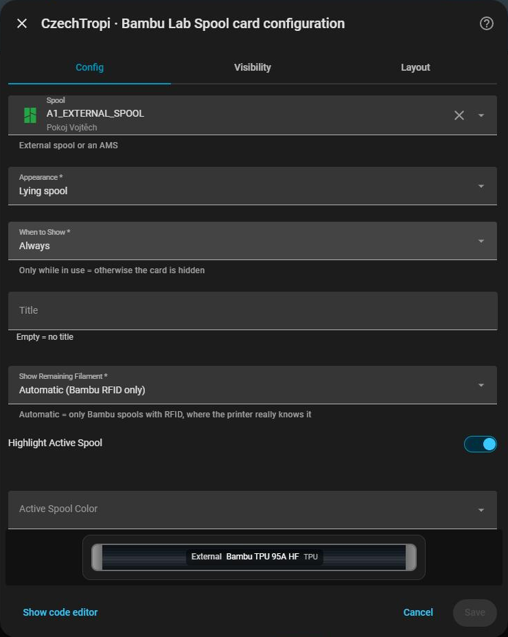
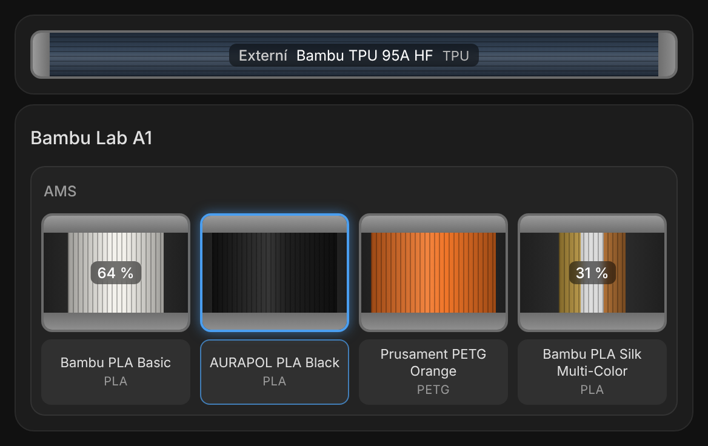

# Bambu Lab Printer Card

[](https://hacs.xyz/docs/faq/custom_repositories)

[](https://my.home-assistant.io/redirect/hacs_repository/?owner=CzechTropi&repository=bambulab-card&category=plugin)

**English** · [Česky](#česky)

Minimalist Home Assistant dashboard cards for Bambu Lab 3D printers:

- **Printer** – live camera / print preview, nozzle & bed temperatures, print progress with ETA, HMS errors, chamber light and smart-plug power
- **AMS** – one or more AMS units, styled like the AMS in Bambu Studio
- **Spool** – the external spool (also for printers without an AMS) or one AMS tray, in four looks

Works with all Bambu Lab printers supported by the [ha-bambulab](https://github.com/greghesp/ha-bambulab) integration. In the card picker they are listed as **CzechTropi · Bambu Lab …**, so you can tell them apart from the integration's own cards.



<table>
  <tr>
    <td align="center"><br><sub>Print preview – one tap on the image icon</sub></td>
    <td align="center"><br><sub>Current stage while preparing the print</sub></td>
    <td align="center"><br><sub>Visual editor</sub></td>
  </tr>
</table>

## Features

- Live camera with a one-tap switch to the print preview (cover image)
- Status line with the current stage (bed leveling, heating, filament change, pause reason…)
- Nozzle and bed temperature chips (current / target)
- Progress bar, layer count, remaining time, start and finish time
- HMS and print errors with a link to the Bambu wiki
- Chamber light toggle, optional smart plug (power state + wattage)
- AMS card for any number of AMS units, with your own humidity / temperature sensors if you like (e.g. from a filament dryer)
- Spool card for the external spool: spool, slim line, lying spool or panel – can show itself only while it is in use
- Visual editors for everything, customizable icons and colors
- Czech and English UI (follows your Home Assistant language)

## Requirements

- Home Assistant 2024.8 or newer
- [ha-bambulab](https://github.com/greghesp/ha-bambulab) integration

The cards find the printer entities automatically by their `translation_key` on the selected device, so renaming entities doesn't break them. If some part is missing (e.g. layers or start/end time), make sure the corresponding entity is **enabled** in the device settings.

## Installation

### Marketplace / HACS (recommended)

[](https://my.home-assistant.io/redirect/hacs_repository/?owner=CzechTropi&repository=bambulab-card&category=plugin)

Click the button above and download the card, then reload the browser (Ctrl+F5). Or by hand:

- **Home Assistant 2026.11+:** Settings → **Marketplace** → **Add from link** → `https://github.com/CzechTropi/bambulab-card`
- **Older versions (HACS):** HACS → ⋮ → **Custom repositories** → the same URL, type **Dashboard**

### Manual

1. Copy `bambulab-card.js` to `/config/www/`
2. Settings → Dashboards → ⋮ → **Resources** → Add resource: `/local/bambulab-card.js?v=1`, type **JavaScript module**
3. Reload the browser

After replacing the file with a newer version, raise the number in the resource URL (`?v=2`, `?v=3`…) – browsers keep files from `/local/` cached for weeks.

## Printer card

Add **CzechTropi · Bambu Lab Printer** from the card picker and pick your printer in the editor, or use YAML:

```yaml
type: custom:bambulab-card
printer: <device_id>            # Bambu Lab device (pick it in the visual editor)
power_switch: switch.printer_plug  # optional – smart plug
camera: camera.my_camera        # optional – defaults to the printer camera
name: My printer                # optional – defaults to the device name
```

| Option | Description |
| --- | --- |
| `printer` | **Required.** Device from the Bambu Lab integration |
| `power_switch` | Smart plug / switch powering the printer. Wattage is read from a `power` sensor on the same device |
| `power_sensor` | Override the power sensor |
| `camera` | Camera entity (default: printer camera) |
| `preview`, `light` | Override the preview image / chamber light entity |
| `name` | Card title |
| `icon_light`, `icon_power`, `icon_nozzle`, `icon_bed`, `icon_usage` | Custom icons (`mdi:…`) |
| `color_light`, `color_power`, `color_nozzle`, `color_bed`, `color_progress` | Custom colors (HA color name or CSS color) |
| `entities` | Map to override any resolved entity, e.g. `{ progress: sensor.xyz }` |

## AMS & spool cards

Put the **Spool** card above or below the **AMS** card (both full width) and they line up as one block. **The remaining % is shown only where the printer really knows it** (Bambu spools with RFID) – third-party filament always reports 100 %, so it's hidden by default. Tap a spool for its details.


### AMS card

**CzechTropi · Bambu Lab AMS** shows one or more AMS units in the order you pick them. As many AMS fit in a row as the width allows, the rows are evened out (2 + 2, not 3 + 1) and every spool keeps the same size. A one-spool unit like the AMS HT shows its humidity and temperature under the spool.


The AMS Lite has no humidity or temperature sensor – but you can pick **your own sensors** for any AMS, e.g. from a filament dryer. They replace the AMS readings; fill in just one and the other still comes from the AMS.

<table>
  <tr>
    <td align="center"><br><sub>AMS Lite with the humidity and temperature of a dryer</sub></td>
    <td align="center"><br><sub>AMS card editor</sub></td>
  </tr>
</table>

Two looks: **spool** and **compact**.



```yaml
type: custom:bambulab-ams-card
ams:                                  # AMS units, in this order
  - <AMS device_id>
custom_humidity: sensor.dryer_humidity        # optional, with one AMS
custom_temperature: sensor.dryer_temperature  # optional, with one AMS
```

With several AMS, the editor offers a sensor pair for each of them; in YAML:

```yaml
custom_sensors:
  <AMS device_id>:
    humidity: sensor.dryer_humidity
    temperature: sensor.dryer_temperature
```

### Spool card

**CzechTropi · Bambu Lab Spool** shows the external spool – so it works for printers without an AMS too – or one AMS tray. Pick how it looks and whether it should be visible only while the printer prints from it (the card is hidden otherwise, and shown dimmed while you edit the dashboard).




```yaml
type: custom:bambulab-spool-card
spool: <external spool device_id>     # or an AMS device + tray: 1–4 (9 on an AMS 3H)
external_style: ribbon                # normal (default), slim, ribbon (lying spool), panel
show_external: active                 # always (default) or active = only while in use
```

### Options

| Option | Card | Default | Description |
| --- | --- | --- | --- |
| `ams` | AMS | – | **Required.** AMS units, shown in this order |
| `custom_humidity`, `custom_temperature` | AMS | – | Own sensors instead of the AMS ones (one AMS) |
| `custom_sensors` | AMS | – | Own sensors per AMS: `{ <AMS device_id>: { humidity, temperature } }` |
| `show_info` | AMS | `true` | Humidity and temperature of each AMS |
| `show_labels` | AMS | `true` | AMS names |
| `spool`, `tray` | Spool | – | **Required.** The external spool, or an AMS with `tray` |
| `external_style` | Spool | `normal` | `normal`, `slim`, `ribbon` (lying spool), `panel` |
| `show_external` | Spool | `always` | `always`, or `active` = only while printing from it |
| `title` | both | – | Card title |
| `show_remaining` | both | `auto` | `auto` = Bambu RFID only, `always`, `never` |
| `style` | both | `spool` | `spool` or `compact` (Spool card: normal look only) |
| `show_name`, `show_type` | both | `true` | Filament name / type under the spool (Spool card: normal look only) |
| `highlight_active`, `color_active` | both | `true`, blue | Highlight of the spool that is printing |

Advanced, YAML only: `overrides` per spool sensor (`name`, `remaining`, `color`, `max`), `name_1`…`4` / `remaining_1`…`4` with a single AMS, and `entity` / `name` / `remaining` on the Spool card.

Older dashboards with the combined `custom:bambulab-filament-card` (AMS + external spool in one card) keep working; it is no longer offered in the card picker.

---

## Česky

Minimalistické karty do Home Assistantu pro 3D tiskárny Bambu Lab:

- **Printer** – živá kamera / náhled tisku, teplota trysky a podložky, průběh tisku s časem dokončení, HMS chyby, světlo a napájení přes chytrou zásuvku
- **AMS** – jedno nebo více AMS ve stylu Bambu Studia
- **Spool** – externí špulka (i pro tiskárny bez AMS) nebo jeden slot AMS, ve čtyřech podobách

Fungují se všemi tiskárnami Bambu Lab, které podporuje integrace [ha-bambulab](https://github.com/greghesp/ha-bambulab). Ve výběru karet je najdeš jako **CzechTropi · Bambu Lab …**, takže se nepletou s kartami samotné integrace.


### Předpoklady

- Home Assistant 2024.8 nebo novější
- Integrace [ha-bambulab](https://github.com/greghesp/ha-bambulab)

Karty si entity najdou samy podle `translation_key` na vybraném zařízení, takže jim nevadí přejmenování entit. Pokud se některá část nezobrazuje (vrstvy, čas startu/konce…), zkontroluj, že je daná entita v nastavení zařízení **povolená**.

### Instalace (Marketplace / HACS)

[](https://my.home-assistant.io/redirect/hacs_repository/?owner=CzechTropi&repository=bambulab-card&category=plugin)

Klikni na tlačítko, stáhni kartu a obnov prohlížeč (Ctrl+F5). Nebo ručně:

- **Home Assistant 2026.11+:** Nastavení → **Marketplace** → **Add from link** (Přidat z odkazu) → `https://github.com/CzechTropi/bambulab-card`
- **Starší verze (HACS):** HACS → ⋮ → **Vlastní repozitáře** → stejná adresa, typ **Dashboard**

Při ruční instalaci (soubor v `/config/www/`) po každé výměně souboru zvyš číslo v adrese zdroje (`/local/bambulab-card.js?v=2`…), jinak prohlížeč použije starou verzi z mezipaměti.

### Použití

Všechno se nastavuje ve vizuálním editoru, volby v YAML jsou v [anglické části](#options).

- **Printer** – vyber tiskárnu, volitelně zásuvku, kameru, název, vlastní ikony a barvy.
- **AMS** – vyber jedno nebo více AMS (zobrazí se v pořadí, v jakém je přidáš). Všechny špulky jsou stejně velké a řádky se zarovnají podle šířky. U každého AMS můžeš zvolit **vlastní senzor vlhkosti a teploty** – hodí se hlavně u AMS Lite, které vlastní senzory nemá, třeba se senzorem ze sušičky.
- **Spool** – externí špulka (funguje i u tiskáren bez AMS) nebo slot AMS. Vzhled: normální špulka, slim (jeden řádek), ležící špulka nebo panel. Může se zobrazit jen ve chvíli, kdy se z ní tiskne.

Když kartu Spool dáš nad nebo pod kartu AMS (obě přes celou šířku), lícují spolu. **Procenta zbývajícího filamentu se ukážou jen tam, kde je tiskárna opravdu zná** (Bambu s RFID).



## License

MIT
