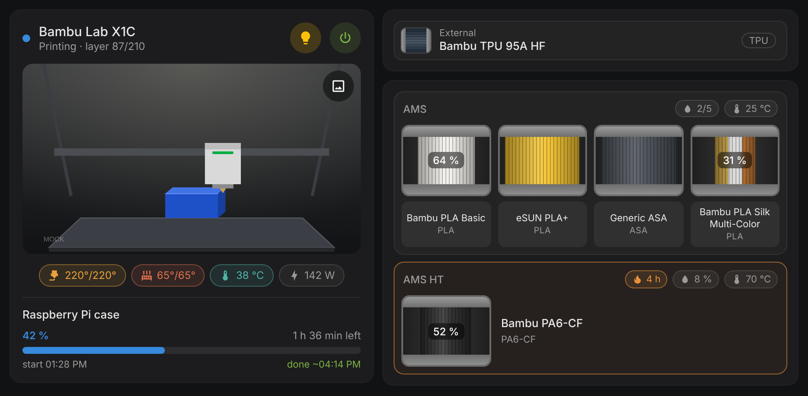
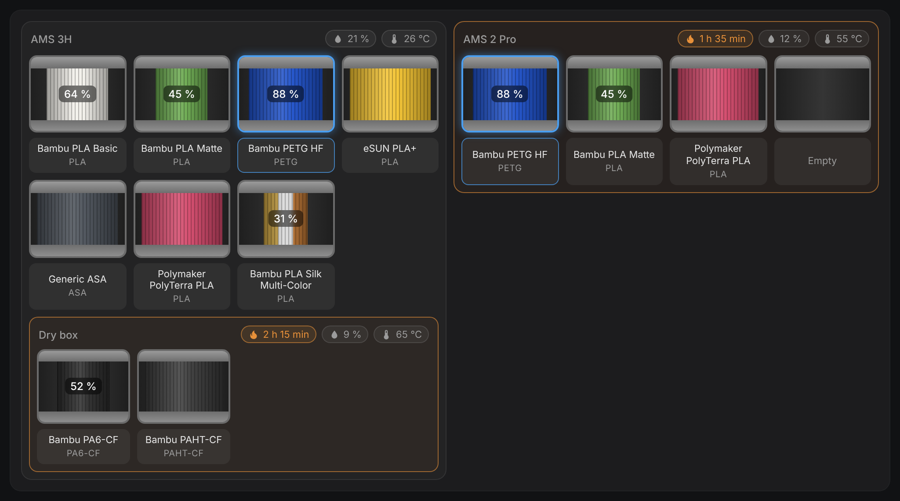
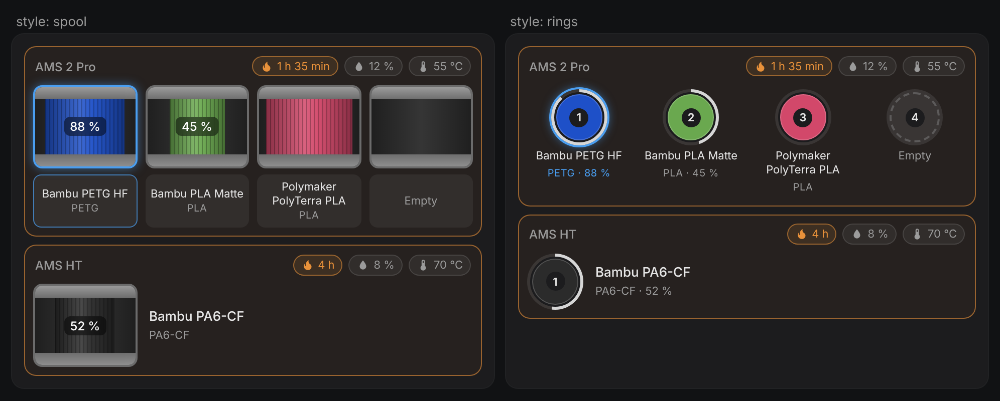
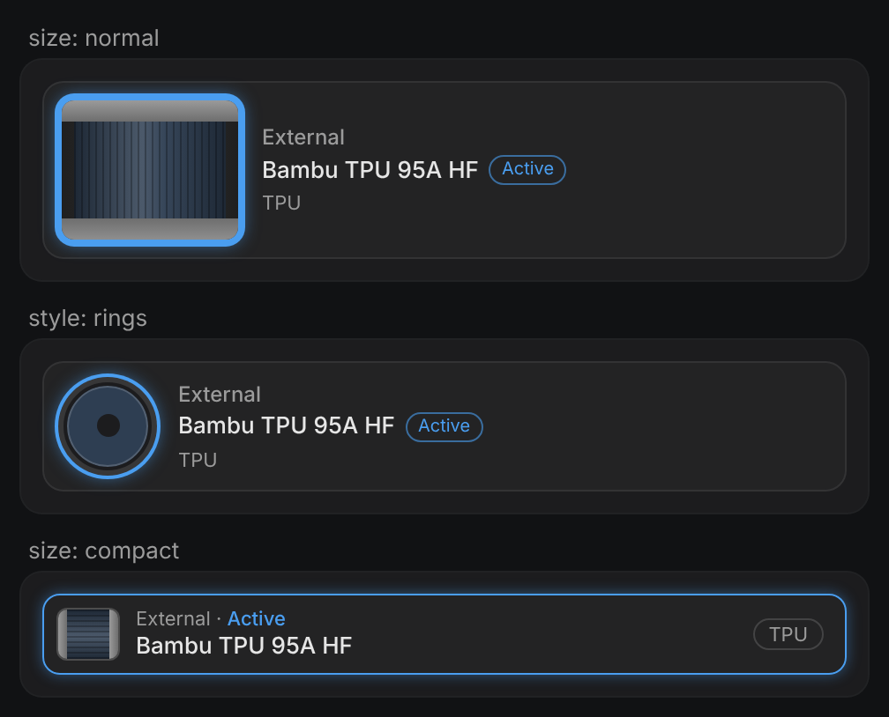

# Bambu Lab Cards

[](https://hacs.xyz/docs/faq/custom_repositories)
[](https://my.home-assistant.io/redirect/hacs_repository/?owner=CzechTropi&repository=bambulab-card&category=plugin)

**English** · [Česky](#česky)

Minimalist Home Assistant dashboard cards for Bambu Lab 3D printers, built on the [ha-bambulab](https://github.com/greghesp/ha-bambulab) integration.



| Card | What it shows |
| --- | --- |
| [**Printer**](#printer-card) | Camera, print progress, temperatures and errors |
| [**AMS**](#ams-card) | The spools in one or more AMS units, styled like Bambu Studio |
| [**Spool**](#spool-card) | The external spool or a single AMS tray |

In the card picker they are **CzechTropi · Bambu Lab Printer / AMS / Spool**. Everything is set up in the visual editor, in English or Czech by your Home Assistant language. No printer at hand? Every card has [mock data](#mock-data) – all the screenshots here are made with it.

## Installation

Click the **Open in your Home Assistant** button above, download the card and reload the browser (Ctrl+F5). Or add it by hand:

- **Home Assistant 2026.11+:** Settings → **Marketplace** → **Add from link** → `https://github.com/CzechTropi/bambulab-card`
- **Older versions (HACS):** HACS → ⋮ → **Custom repositories** → the same URL, type **Dashboard**

Needs Home Assistant 2024.8+ and the [ha-bambulab](https://github.com/greghesp/ha-bambulab) integration. The cards find the printer's entities by themselves, renamed entities included. If something is missing (layers, start / end time), enable that entity in the device settings.

## Printer card


- Live camera – one tap switches to the print preview
- Status with the current stage: bed leveling, heating, filament change, pause reason…
- Nozzle and bed temperature – and the chamber on printers that have its sensor (X1, H2D…)
- Progress, layers, time left and estimated finish
- HMS and print errors with a link to the Bambu wiki
- Chamber light and an optional smart plug with live wattage
- A printer that is off shows no stale temperatures, with or without a smart plug

<table>
  <tr>
    <td align="center"><br><sub>One tap on the camera button shows the print preview</sub></td>
    <td align="center"><br><sub>The current stage while preparing the print</sub></td>
  </tr>
</table>

## AMS card

One or more AMS units in the order you pick them.

- Color, name, type and remaining filament of every spool; the spool in use is highlighted
- Humidity and temperature of every AMS – or **your own sensors**, e.g. from a filament dryer (handy for the AMS Lite, which has none)
- **AMS 3H (H3C):** the main zone and the dry box, each with its own humidity and temperature
- **Drying** (AMS 3H, AMS 2 Pro, AMS HT): a flame chip with the time left and an orange frame
- Tap a spool for the same filament dialog as the ha-bambulab cards (type, color, load, unload, RFID)
- Every AMS has the same width: stacked in a normal column, side by side in a wider section



**Style** – drawn spools or rings (the ring shows the remaining filament):



**Size** – compact keeps everything but puts each spool in a small tile, four in a row, so an AMS takes a single row. Handy with several AMS on one printer:


## Spool card

The external spool – so it works for printers without an AMS too – or a single AMS tray, in the same look as the AMS card. It can show only while the printer prints from it.



## Mock data

At the top of each card editor, switch **Data Source** to **Mock data (MOCK)** and pick what to see: a printer state (with a drawn camera), any mix of AMS models including the AMS 3H, or the external spool. Nothing is read from or sent to the printer, so you can try a look – or an AMS you don't own – before setting up the real card. Every screenshot in this README is made from these mock data.

## Options

Everything is in the visual editor; the YAML options are here for reference.

<details>
<summary><b>Printer card</b></summary>

| Option | Default | Description |
| --- | --- | --- |
| `printer` | – | **Required.** The printer device |
| `power_switch` | – | Smart plug of the printer – the wattage is read from the same device |
| `camera` | printer camera | Camera entity |
| `name` | device name | Card title |
| `icon_*`, `color_*` | – | Own icons and colors: light, power, nozzle, bed, chamber, usage, progress |

```yaml
type: custom:bambulab-card
printer: <device_id>
power_switch: switch.printer_plug
```
</details>

<details>
<summary><b>AMS card</b></summary>

| Option | Default | Description |
| --- | --- | --- |
| `ams` | – | **Required.** AMS units, in display order |
| `style` | `spool` | `spool` or `rings` |
| `size` | `normal` | `normal` or `compact` |
| `custom_humidity`, `custom_temperature` | – | Own sensors (with several AMS: `custom_sensors`, set in the editor per AMS) |
| `show_labels` | on | AMS names |

```yaml
type: custom:bambulab-ams-card
ams:
  - <AMS device_id>
style: rings
size: compact
custom_humidity: sensor.dryer_humidity
custom_temperature: sensor.dryer_temperature
```
</details>

<details>
<summary><b>Spool card</b></summary>

| Option | Default | Description |
| --- | --- | --- |
| `spool` | – | **Required.** The external spool, or an AMS together with `tray` |
| `style` | `spool` | `spool` or `rings` |
| `size` | `normal` | `normal` or `compact` (one slim line) |
| `show_external` | `always` | `always`, or `active` – shown only while the printer prints from this spool |

```yaml
type: custom:bambulab-spool-card
spool: <external spool device_id>
size: compact
show_external: active
```
</details>

<details>
<summary><b>Both filament cards</b></summary>

`title`, `show_name`, `show_type`, `highlight_active`, `color_active` and `show_remaining`. The remaining percentage is only known for Bambu spools with RFID – the printer reports 100 % for anything else, so by default it is hidden there.

Older configs keep working: `style: compact` shows rings, `external_style: slim` is the compact spool card and `panel` the normal one.
</details>

<details>
<summary><b>Mock data</b></summary>

```yaml
type: custom:bambulab-card
printer: MOCK
mock: printing        # pause, prepare, finish, idle, error
```

```yaml
type: custom:bambulab-ams-card
ams: MOCK
mock: [ams_3h, ams_2_pro, ams_ht, ams, ams_lite]
```

```yaml
type: custom:bambulab-spool-card
spool: MOCK
mock: external_active # external, ams_tray
```
</details>

---

## Česky

Minimalistické karty do Home Assistantu pro 3D tiskárny Bambu Lab, postavené na integraci [ha-bambulab](https://github.com/greghesp/ha-bambulab).

| Karta | Co ukazuje |
| --- | --- |
| **Printer** | Kamera, průběh tisku, teploty a chyby |
| **AMS** | Špulky v jednom nebo více AMS, ve stylu Bambu Studia |
| **Spool** | Externí špulka nebo jeden slot AMS |

Ve výběru karet jsou jako **CzechTropi · Bambu Lab Printer / AMS / Spool**. Všechno se nastavuje ve vizuálním editoru, česky nebo anglicky podle jazyka Home Assistantu.


**Instalace** – klikni na tlačítko **Open in your Home Assistant** nahoře, stáhni kartu a obnov prohlížeč (Ctrl+F5). Nebo Nastavení → **Marketplace** → **Add from link** → `https://github.com/CzechTropi/bambulab-card`.

### Printer

- Živá kamera, klepnutím přepneš na náhled tisku
- Aktuální fáze tisku: vyrovnávání podložky, ohřev, výměna filamentu, důvod pozastavení…
- Teplota trysky a podložky – a komory u tiskáren, které mají její senzor (X1, H2D…)
- Průběh, vrstvy, zbývající čas a odhad dokončení
- HMS chyby s odkazem na wiki Bambu
- Světlo a volitelně chytrá zásuvka s příkonem
- Vypnutá tiskárna neukazuje staré teploty, i bez chytré zásuvky

### AMS

- Barva, název, typ a zbývající filament každé špulky, aktivní špulka je zvýrazněná
- Vlhkost a teplota každého AMS – nebo **vlastní senzory**, třeba ze sušičky (hodí se u AMS Lite, které je nemá)
- **AMS 3H (H3C):** hlavní zóna a sušicí box, každý se svou vlhkostí a teplotou
- **Sušení** (AMS 3H, AMS 2 Pro, AMS HT): čip s ohýnkem a zbývajícím časem, oranžový rámeček
- Klepnutím na špulku otevřeš stejný dialog filamentu jako v kartách ha-bambulab (typ, barva, zavést, vysunout, RFID)
- **Styl:** kreslené špulky, nebo kolečka (prstenec ukazuje zbývající filament)
- **Velikost:** kompaktní ukáže všechno, jen každou špulku jako malou dlaždici – jedno AMS zabere jediný řádek

### Spool

- Externí špulka (funguje i u tiskáren bez AMS) nebo jeden slot AMS, ve stejném vzhledu jako karta AMS
- Kompaktní velikost je jeden úzký řádek
- Může se ukázat jen ve chvíli, kdy se z ní tiskne

### Ukázková data (MOCK)

V editoru každé karty přepni nahoře **Zdroj dat** na **Ukázková data (MOCK)** a vyber, co chceš vidět – stav tiskárny, libovolná AMS včetně AMS 3H nebo externí špulku. Z tiskárny se nic nečte ani se do ní nic neposílá. Z těchto dat jsou i všechny obrázky v tomto README.

Procenta zbývajícího filamentu zná tiskárna jen u špulek Bambu s RFID, u ostatních je karta ve výchozím stavu skrývá. Volby v YAML jsou v [anglické části](#options).

## License

MIT
