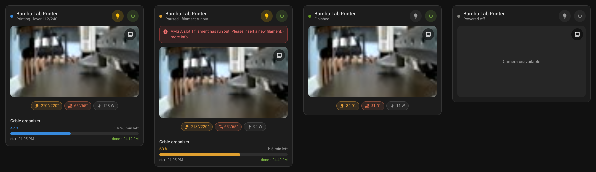
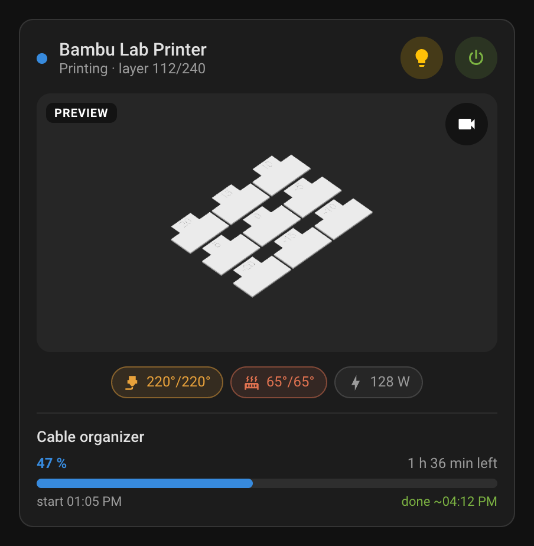
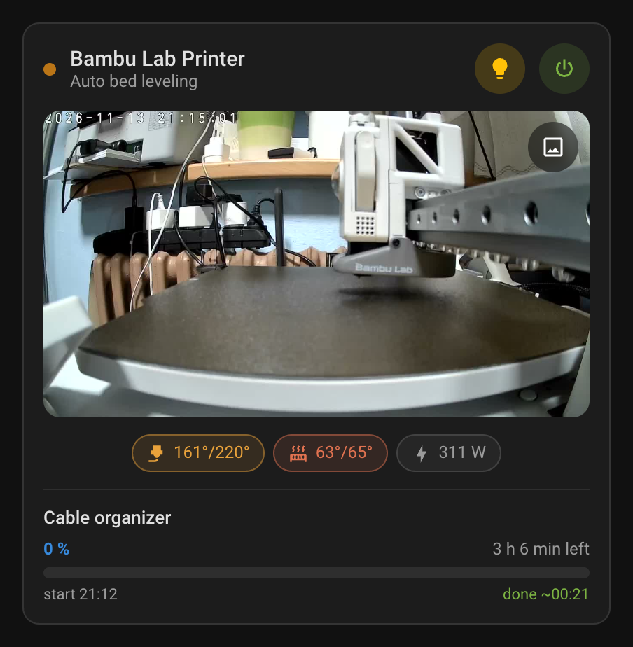
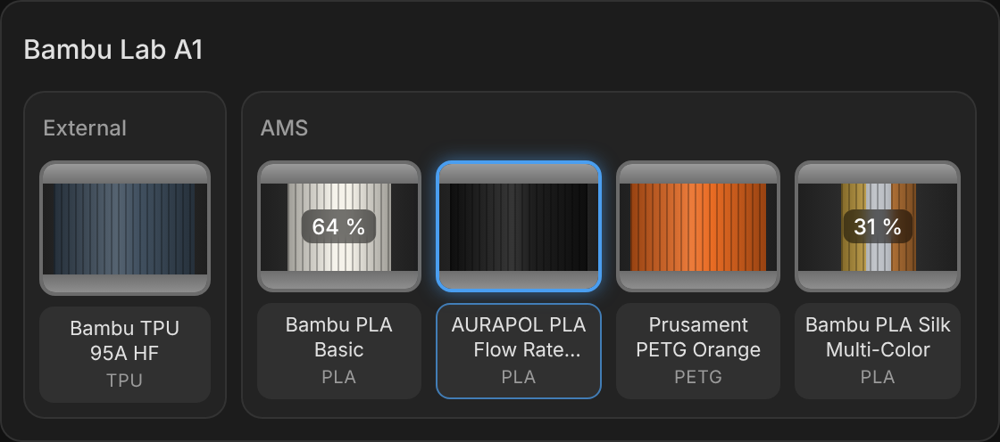
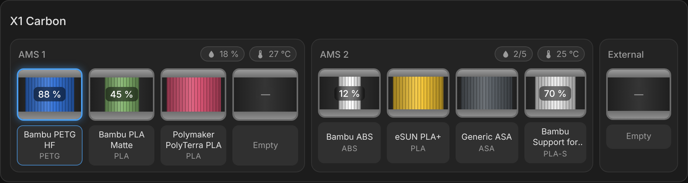
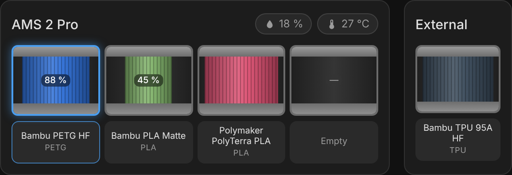
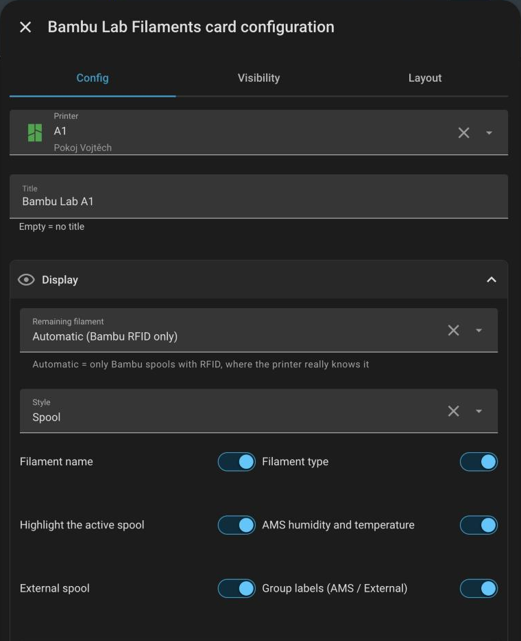
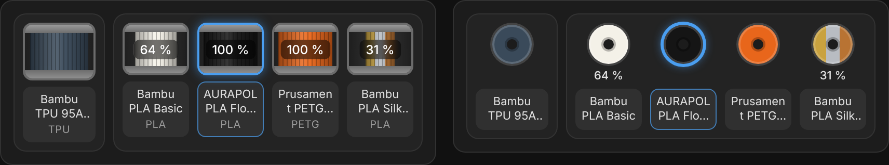
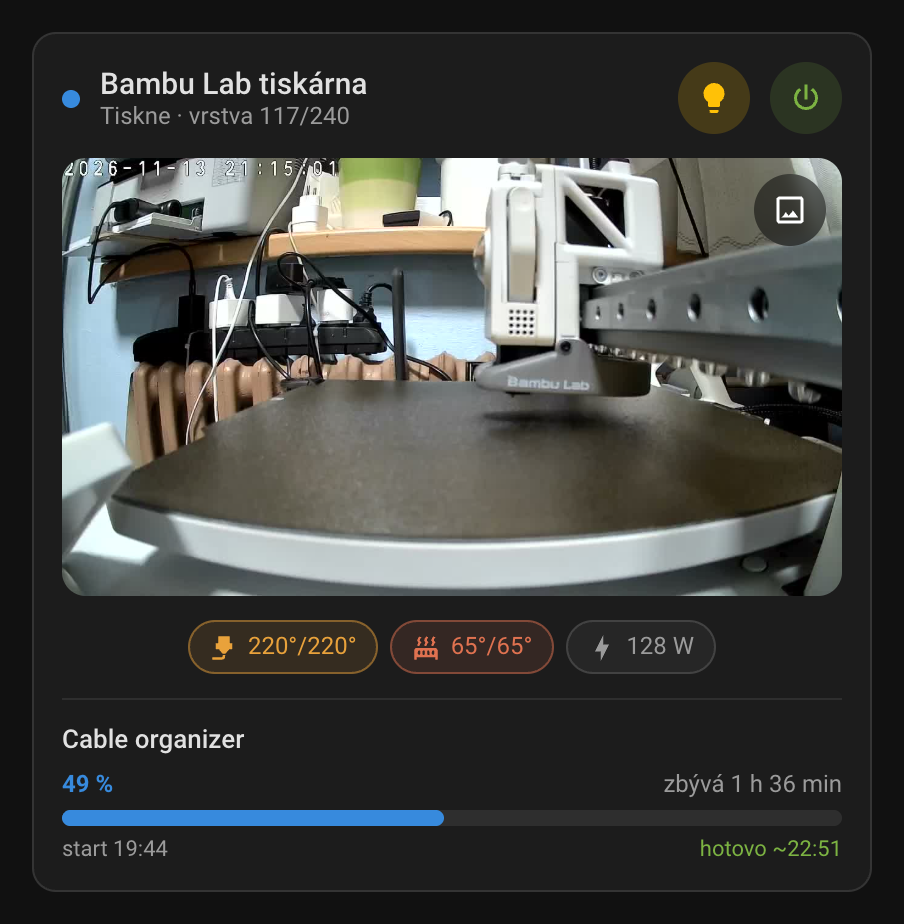
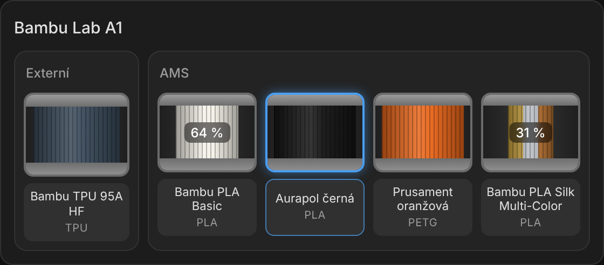

# Bambu Lab Printer Card

[](https://hacs.xyz/docs/faq/custom_repositories)

**English** · [Česky](#česky)

A minimalist Home Assistant dashboard card for Bambu Lab 3D printers: live camera / print preview, nozzle & bed temperatures, print progress with ETA, HMS errors, chamber light and smart-plug power.

Also includes [filament cards](#filament-cards-ams--external-spool) for the AMS and the external spool.

Works with all Bambu Lab printers supported by the [ha-bambulab](https://github.com/greghesp/ha-bambulab) integration.



<table>
  <tr>
    <td align="center"><br><sub>Print preview – one tap on the image icon</sub></td>
    <td align="center"><br><sub>Current stage while preparing the print</sub></td>
  </tr>
</table>

## Features

- Live camera with a one-tap switch to the print preview (cover image)
- Status line with the current stage (bed leveling, heating, filament change, pause reason…)
- Nozzle and bed temperature chips (current / target)
- Progress bar, layer count, remaining time, start and finish time
- HMS and print errors with a link to the Bambu wiki
- Chamber light toggle, optional smart plug (power state + wattage)
- Visual editor, customizable icons and colors
- Czech and English UI (follows your Home Assistant language)

## Requirements

- Home Assistant 2024.8 or newer
- [ha-bambulab](https://github.com/greghesp/ha-bambulab) integration (HACS)

The card finds the printer entities automatically by their `translation_key` on the selected device, so renaming entities doesn't break it. If some part is missing (e.g. layers or start/end time), make sure the corresponding entity is **enabled** in the device settings.

## Installation

### HACS (recommended)

1. HACS → ⋮ (top right) → **Custom repositories**
2. Repository: `https://github.com/CzechTropi/bambulab-card`, type: **Dashboard**
3. Find **Bambu Lab Printer Card** in HACS and download it
4. Reload the browser (Ctrl+F5)

### Manual

1. Copy `bambulab-card.js` to `/config/www/`
2. Settings → Dashboards → ⋮ → **Resources** → Add resource: `/local/bambulab-card.js`, type **JavaScript module**
3. Reload the browser

## Configuration

Add the card from the card picker (search for **Bambu Lab**) and pick your printer in the editor, or use YAML:

```yaml
type: custom:bambulab-card
printer: <device_id>            # Bambu Lab device (pick it in the visual editor)
power_switch: switch.printer_plug  # optional – smart plug
camera: camera.my_camera        # optional – defaults to the printer camera
name: My printer                # optional – defaults to the device name
```

| Option | Description |
| --- | --- |
| `printer` | **Required.** Device from the Bambu Lab integration |
| `power_switch` | Smart plug / switch powering the printer. Wattage is read from a `power` sensor on the same device |
| `power_sensor` | Override the power sensor |
| `camera` | Camera entity (default: printer camera) |
| `preview`, `light` | Override the preview image / chamber light entity |
| `name` | Card title |
| `icon_light`, `icon_power`, `icon_nozzle`, `icon_bed`, `icon_usage` | Custom icons (`mdi:…`) |
| `color_light`, `color_power`, `color_nozzle`, `color_bed`, `color_progress` | Custom colors (HA color name or CSS color) |
| `entities` | Map to override any resolved entity, e.g. `{ progress: sensor.xyz }` |

## Filament cards (AMS & external spool)

The same file also contains three cards for your filaments. They look like the AMS in Bambu Studio, but you decide what they show. The main reason they exist: **the remaining-filament % is only shown when the printer really knows it** (Bambu spools with an RFID tag). Third-party filament always reports 100 %, so that number is hidden by default.



| Card | What it shows |
| --- | --- |
| `custom:bambulab-filament-card` | Everything of one printer in one card: all AMS units + the external spool, side by side |
| `custom:bambulab-ams-card` | One AMS unit, with humidity and temperature |
| `custom:bambulab-spool-card` | Just the external spool (small, fits next to anything) |



<table>
  <tr>
    <td align="center"><br><sub>AMS card and external spool card</sub></td>
    <td align="center" rowspan="2"><br><sub>Everything is set in the visual editor</sub></td>
  </tr>
  <tr>
    <td align="center"><br><sub>Remaining % always shown · compact style</sub></td>
  </tr>
</table>

### Features

- Spool drawing in the filament color (multi-color filaments too); the winding gets thinner as the spool empties
- Active spool highlighted (color configurable)
- Filament name, type, remaining amount – each can be turned off
- Remaining filament: automatic (Bambu RFID only), always, never – or your own entity per slot (e.g. an `input_number` in % or grams you update yourself)
- Your own name per slot (e.g. *Aurapol black* instead of *AURAPOL PLA Flow Rate Calibrated*)
- AMS humidity and temperature (hidden on AMS Lite, which has no sensors)
- Two styles: `spool` and `compact`
- Tap a spool for its details
- Finds the AMS units and the external spool of the printer by itself, works with several AMS units

### Configuration

All three cards are in the card picker (search for **Bambu Lab**). YAML:

```yaml
type: custom:bambulab-filament-card
printer: <device_id>          # the printer device
title: Bambu Lab A1           # optional
external_position: start      # start | end
show_remaining: auto          # auto | always | never
overrides:                    # optional, per spool sensor
  sensor.a1_ams_tray_2:
    name: Aurapol black
    remaining: input_number.aurapol_black_grams
```

```yaml
type: custom:bambulab-ams-card
ams: <device_id>              # the AMS device
name_2: Aurapol black         # optional, per slot 1–4
remaining_2: input_number.aurapol_black   # optional, per slot 1–4
```

```yaml
type: custom:bambulab-spool-card
spool: <device_id>            # the External Spool device (or entity: sensor.xxx_external_spool)
```

Tip: next to an AMS card, give the spool card a `title` too (e.g. *External*) – both cards then line up exactly.

| Option | Cards | Default | Description |
| --- | --- | --- | --- |
| `printer` | filament | – | **Required.** Printer device |
| `ams` | ams / filament | – | AMS device (filament card: optional list to show only some AMS units) |
| `spool`, `entity` | spool | – | External spool device, or a spool sensor directly |
| `title` | all | – | Card title |
| `show_remaining` | all | `auto` | `auto` = Bambu RFID spools only, `always` = whenever the printer reports a value, `never` |
| `show_name`, `show_type` | all | `true` | Filament name / type under the spool |
| `highlight_active` | all | `true` | Highlight the spool that is printing |
| `color_active` | all | blue | Color of the highlight (HA color name or CSS color) |
| `style` | all | `spool` | `spool` or `compact` |
| `show_info` | ams / filament | `true` | AMS humidity and temperature |
| `show_external` | filament | `true` | Show the external spool |
| `external_position` | filament | `start` | `start` (left) or `end` (right) |
| `show_labels` | filament | `true` | Group labels (*AMS*, *External*) |
| `name_1`…`name_4`, `remaining_1`…`remaining_4` | ams | – | Custom name / remaining-filament entity per slot |
| `name`, `remaining` | spool | – | Custom name / remaining-filament entity |
| `overrides` | all | – | Per spool sensor: `name`, `remaining`, `color`, `max` (full amount for the remaining entity, default 100 %, 1000 g or 1 kg) |

---

## Česky

Minimalistická karta do Home Assistantu pro 3D tiskárny Bambu Lab: živá kamera / náhled tisku, teplota trysky a podložky, průběh tisku s časem dokončení, HMS chyby, světlo a napájení přes chytrou zásuvku. K tomu [karty na filament](#karty-na-filament-ams-a-externí-špulka) pro AMS a externí špulku.

Funguje se všemi tiskárnami Bambu Lab, které podporuje integrace [ha-bambulab](https://github.com/greghesp/ha-bambulab).



### Předpoklady

- Home Assistant 2024.8 nebo novější
- Integrace [ha-bambulab](https://github.com/greghesp/ha-bambulab) (z HACS)

Karta si entity najde sama podle `translation_key` na vybraném zařízení, takže jí nevadí přejmenování entit. Pokud se některá část nezobrazuje (vrstvy, čas startu/konce…), zkontroluj, že je daná entita v nastavení zařízení **povolená**.

### Instalace přes HACS

1. HACS → ⋮ (vpravo nahoře) → **Vlastní repozitáře**
2. Repozitář: `https://github.com/CzechTropi/bambulab-card`, typ: **Dashboard**
3. Najdi v HACS **Bambu Lab Printer Card** a stáhni
4. Obnov prohlížeč (Ctrl+F5)

### Použití

Přidej kartu přes výběr karet (hledej **Bambu Lab**) a v editoru vyber svou tiskárnu. Volitelně přidej zásuvku, kameru, název, vlastní ikony a barvy.

### Karty na filament (AMS a externí špulka)

Ve stejném souboru jsou i tři karty na filament. Vypadají podobně jako AMS v Bambu Studiu, ale co ukazují, si nastavíš sám. Hlavní důvod: **procenta zbývajícího filamentu se ukážou jen tam, kde je tiskárna opravdu zná** (špulky Bambu s RFID). U filamentu jiných výrobců tiskárna hlásí vždycky 100 %, proto je karta ve výchozím stavu schová.



| Karta | Co ukazuje |
| --- | --- |
| `custom:bambulab-filament-card` | Všechno z jedné tiskárny: všechna AMS + externí špulku vedle sebe |
| `custom:bambulab-ams-card` | Jedno AMS s vlhkostí a teplotou |
| `custom:bambulab-spool-card` | Jen externí špulku (malá, vejde se vedle čehokoli) |

- špulka v barvě filamentu (i vícebarevné), při ubývání se navinutí zužuje
- zvýraznění aktivní špulky (barva jde změnit)
- název, typ a zbývající množství jdou jednotlivě vypnout
- zbývající filament: automaticky (jen Bambu RFID), vždy, nikdy – nebo vlastní entita pro každý slot (např. `input_number` v % nebo gramech, který si aktualizuješ sám)
- vlastní název pro každý slot (např. *Aurapol černá* místo *AURAPOL PLA Flow Rate Calibrated*)
- vlhkost a teplota AMS (u AMS Lite, které senzory nemá, se schovají)
- dva vzhledy: `spool` (špulka) a `compact` (kompaktní)
- klepnutím na špulku se otevřou podrobnosti
- AMS a externí špulku tiskárny si karta najde sama, zvládne i víc AMS

Všechno se nastavuje ve vizuálním editoru; volby v YAML jsou popsané výše v anglické části.

## License

MIT
